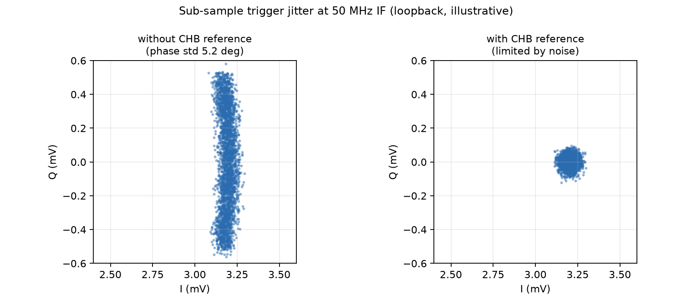
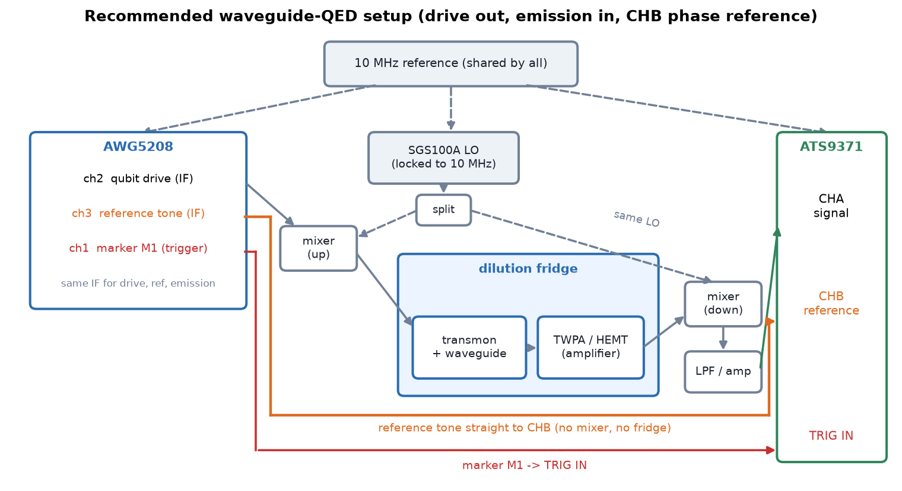

# QAWG 教學

這份教學從零開始，依序說明：

1. [環境與基本概念](#0-環境與基本概念)
2. [只用 AWG：做 waveform、上傳、marker](#1-只用-awg做-waveform上傳執行)
3. [只用 Alazar：擷取 readout waveform](#2-只用-alazar擷取-readout-waveform)
4. [QAWG：用 Program 描述實驗](#3-qawg用-program-描述實驗)
5. [Dispersive 實驗：one-tone、two-tone、Rabi、T1、Ramsey](#4-dispersive-實驗)
6. [Waveguide QED：emission、CHB 相位參考、Wigner function](#5-waveguide-qed)
7. [常見問題](#6-常見問題)

> 本教學的程式碼範例沒有在實際儀器上逐一執行過；測試（`python -m pytest -q`）只用 mock 硬體。
> 第一次在你的儀器上跑時，請先用小的 `n_average` 確認 timing 與接線。

---

## 0. 環境與基本概念

```powershell
conda activate qawg
cd C:\Users\QEL\Desktop\Qawg-main      # 一律從 repo 根目錄執行
python -m pytest -q                    # 確認環境
```

### 三層架構

```text
QAWG.awg5200   只控制 AWG5208（waveform、marker、sequence）   ┐ 可以單獨使用
QAWG.alazar    只控制 ATS9371（capture、解調、濾波、積分）    ┘ 互不相依
QAWG           ExperimentProgram → compile → AWGAlazar 協調兩台儀器
```

一般實驗用最上層 QAWG；`awg5200` 與 `alazar` 適合 debug 或特殊流程。

### 四個必須知道的名詞

| 名詞 | 意思 |
|---|---|
| **IF** | AWG 輸出與 ADC 量到的中頻（例如 50 MHz）。RF = LO + IF |
| **marker** | AWG 的數位輸出，接 ATS 的 TRIG IN，用來觸發擷取 |
| **acquire window** | trigger 之後 ADC 錄下的完整長度 `acquire_window_s` |
| **integration window** | acquire window 中真正拿來算每 shot IQ 的區段 |

```text
marker ↑
       |<-- trigger_delay -->|<---- integrate_time ---->|
       |<------------------ acquire window ------------------>|
```

### 載波相位（重要）

Compiler 產生的波形是

```text
waveform(t) = gain · envelope(t) · sin(2π · frequency · t + phase)
```

`t` 是 sequence step 的**全域時間**（step 第 0 個 sample 為 0，也就是 marker 與 ADC record 的起點）。
所以不同時間的 pulse 與解調共用同一個連續載波：Ramsey 的條紋只來自 detuning，readout 的 IQ 相位不隨 readout 位置改變。
要舊行為（載波在每個 pulse 起點重置）：`ExperimentProgram(cfg, phase_reference="pulse")`。

---

## 1. 只用 AWG：做 waveform、上傳、執行

```python
from QAWG.awg5200 import AWG5208, gaussian_square_ns
from QAWG import waveform, delay_auto

awg = AWG5208.connect("TCPIP0::192.168.10.171::inst0::INSTR")
awg.set_awg_mode()
awg.use_external_10mhz_reference()      # 與 ATS 共用 10 MHz
awg.set_sample_rate(2.5e9)
```

**1. 做 envelope。** 單位是 volt，peak 不可超過 `amplitude_vpp / 2`（`amplitude_vpp=0.5` 時 peak ≤ 0.25 V）。

```python
env = gaussian_square_ns(
    duration_ns=600, sample_rate_hz=2.5e9,
    edge_sigma_ns=20, amplitude_volts=0.25,
)
```

**2. 排 timeline。** `waveform(envelope, fc, ch)` 指定載波頻率與 AWG channel；`/` 串接，`delay_auto(秒)` 從前一個 pulse 結束後算起。

```python
drive = waveform(env, fc=100e6, ch=2, name="drive")
readout = waveform(env, fc=50e6, ch=1, name="readout")
timeline = drive / delay_auto(40e-9) / readout
```

**3. 上傳並執行。** 每個 channel 一個 waveform，`total_duration_s` 是整段長度（至少 2400 samples）。

```python
awg.upload_timeline(timeline, amplitude_vpp={1: 0.5, 2: 0.5}, total_duration_s=2e-6)
awg.marker(waveform_ch=1, marker_ch=1, marker_number=1)   # marker 對齊 ch1 的 pulse
awg.run()
```

**4. 多個 step（sequence）。** 每個 step 一組 waveform，AWG 會依序播放：

```python
from QAWG.awg5200 import AWGProgram, AWGStep
import numpy as np

steps = tuple(
    AWGStep(
        waveforms={1: amp * np.sin(2 * np.pi * 50e6 * np.arange(5000) / 2.5e9)},
        markers={1: (np.arange(5000) < 100,)},       # ch1 的 marker 1
    )
    for amp in (0.05, 0.10, 0.15)
)
awg.upload_program(
    AWGProgram("amp_scan", steps, amplitudes_vpp={1: 0.5},
               marker_levels={(1, 1): (0.0, 1.2)})
)
awg.run()
```

一般實驗不建議手動處理 marker 與 sequence，交給第 3 節的 compiler。

---

## 2. 只用 Alazar：擷取 readout waveform

目標：AWG 送出一個 pulse，ADC 錄下來，看 raw 波形與解調後的 IQ。接線：AWG ch1 → ATS CHA；AWG marker → TRIG IN。

### 2.1 最低階：直接用 `Alazar9371`

```python
import numpy as np
import matplotlib.pyplot as plt
from QAWG.alazar import Alazar9371, CaptureConfig, TriggerConfig, downconvert, integrate
from QAWG.alazar.constants import CHANNEL_A

ats = Alazar9371.connect()
ats.configure(
    trigger=TriggerConfig(level=140),        # TTL marker 的 trigger level code
    use_external_10mhz_reference=True,
    channel=CHANNEL_A,
)

config = CaptureConfig(samples_per_record=1536, records_per_acquisition=1000, channel=CHANNEL_A)
data = ats.capture(config, start_callback=lambda: awg.run())   # 先 arm ADC，再讓 AWG 開始送

raw = data.records_volts                      # (1000, 1536) 單位 volt
iq = downconvert(raw, 1e9, 50e6)              # 解調到基頻，(1000, 1536) complex
shots = integrate(iq, 200, 800)               # 每 shot 一個 IQ 點，(1000,)

plt.plot(data.time_s * 1e9, raw.mean(axis=0) * 1e3)
plt.xlabel("time after trigger (ns)"); plt.ylabel("raw (mV)")
```

`start_callback` 保證順序：ADC 先 armed，AWG 才開始送，不會漏掉第一個 trigger。

### 2.2 用 QAWG 看 readout waveform（TOF / timing）

這是調整 `trigger_delay`、integration window 最常用的方式。

```python
from QAWG import AWGAlazar, ExperimentProgram, ns, us, MHz

experiment = AWGAlazar.connect(
    "TCPIP0::192.168.10.171::inst0::INSTR",
    awg_sample_rate_hz=2.5e9,
    acquire_window_s=2 * us,        # trigger 之後錄 2 µs
    adc_channel="CHA",
)


class TOF(ExperimentProgram):
    def _initialize(self, cfg):
        self.declare_gen("ro_gen", ch=1, amplitude_vpp=0.5)
        self.declare_readout(
            "ro", adc_channel="CHA", length=1 * us, demod_freq=50 * MHz,
            waveform_ch=1, marker_channel=1, marker_lead=200 * ns,
            integrate_time=1 * us,
        )
        self.add_pulse(
            "ro_pulse", gen="ro_gen", style="gaussian_square",
            length=600 * ns, edge_sigma=20 * ns, frequency=50 * MHz,
            gain=0.5, readout=True,            # readout=True：marker 跟著這個 pulse
        )

    def _body(self, cfg):
        self.play("ro_pulse", at=0)
        self.trigger("ro")


compiled = experiment.compile(TOF({}, final_delay_s=1 * us))
result = compiled.acquire(n_average=1000)

t_ns = result.raw_time_s * 1e9
plt.plot(t_ns, result.raw_average()[0] * 1e3, label="raw")
plt.plot(result.iq_time_s * 1e9, np.abs(result.iq_average()[0]) * 1e3, label="|IQ|")
plt.xlabel("time after trigger (ns)"); plt.ylabel("mV"); plt.legend()
```

怎麼看：pulse 的上升沿出現在 `marker_lead`（200 ns）附近；它與實際看到的位置的差就是線路延遲。
把 `trigger_delay` 設成上升沿位置，integration window 才會對準 pulse。

完整 acquire window 一律保留，隨時可取：

```python
experiment.last_records_volts      # (shot, sample) 原始電壓
experiment.last_downconverted_iq   # (shot, sample) 低通後的 IQ trace
experiment.last_time_s
```

---

## 3. QAWG：用 Program 描述實驗

流程：

```text
ExperimentProgram → compile() → CompiledExperiment → acquire() → ExperimentResult
```

### 3.1 Program 的五個動作

| 動作 | 作用 |
|---|---|
| `declare_gen(name, ch, amplitude_vpp)` | 宣告一個 AWG channel |
| `declare_readout("ro", ...)` | 宣告 ADC channel、解調頻率、marker |
| `add_sweep(name, LinearSweep / ValuesSweep)` | 宣告掃描軸，回傳可以放進參數的變數 |
| `add_pulse(name, gen, style, length, frequency, gain, ...)` | 登記 pulse（此時還不產生波形） |
| `play(...)` / `delay_auto(...)` / `trigger("ro")` | 排程 |

- `style`：`const`、`gaussian`（要 `sigma`）、`gaussian_square`（要 `edge_sigma`）、`cosine_square`（要 `edge_length`）、`exponential_rise`/`exponential_decay`（要 `decay`）。
- `gain` 是滿幅比例（0–1），實際峰值 = `gain × amplitude_vpp / 2`。
- `play("p", at=t)` 指定時間；不給 `at` 就接在前一個 pulse 後面；`delay_auto(d)` 空出 `d`。
- 參數可以是數字，也可以是 sweep 變數，且支援 `+`、`-`（例如 `T_MAX - tau`）。
- `play("p", when=("state", "signal"))`：只在 sweep `state` 等於 `"signal"` 時播放。

### 3.2 Marker 與 trigger_delay

- `readout=True` 的 pulse 會被視為 readout，marker 對準它。
- `marker_lead`：marker 比 readout 起點早多久（預設 500 ns）。
- `trigger_delay`：integration window 在 acquire window 內的起點，預設等於 `marker_lead`。
- **readout 不在 step 開頭時**（前面有 qubit pulse、delay），請加 `marker_at_readout=True`：marker 會移到 readout 前 `marker_lead` 的位置，ADC 只錄 readout 附近，不必錄整個 step。
  所有 step 的 readout 起點必須相同（用 `at=` 固定它）。

### 3.3 取得結果

```python
result = compiled.acquire(n_average=1000)
result.iq_shots     # (n_average, P)         每 shot 一個 IQ 點（integration window 內）
result.iq_traces    # (n_average, P, sample) 解調後的 IQ trace
result.raw          # (n_average, P, sample) 原始電壓
result.s21()        # (P,) 所有 shot 平均後的 IQ
result.axis("amp")  # 掃描軸的值
```

`P` 是 sweep 點數。資料預設保留 shot 軸，不會自動丟掉 single-shot 資訊。
**記憶體注意**：`raw` 與 `iq_traces` 的大小是 `n_average × P × sample`，點數多時請分批 acquire 再累加。

### 3.4 只改外部儀器時：上傳一次，多次量測

```python
compiled.upload()                 # AWG 波形只上傳一次
for f in lo_frequencies:
    sgs.frequency = float(f)
    result = compiled.acquire(n_average=1000)
```

---

## 4. Dispersive 實驗

以下範例共用同一組設定與 readout 宣告（`marker_at_readout=True`）：

```python
import numpy as np
import matplotlib.pyplot as plt
from QAWG import AWGAlazar, ExperimentProgram, LinearSweep, ValuesSweep, MHz, ns, us

experiment = AWGAlazar.connect(
    "TCPIP0::192.168.10.171::inst0::INSTR",
    awg_sample_rate_hz=2.5e9, acquire_window_s=2 * us, adc_channel="CHA",
)


class Base(ExperimentProgram):
    """宣告 qubit / readout channel 與 readout pulse，各實驗繼承它。"""

    def _declare(self, cfg):
        self.declare_gen("qubit", ch=2, amplitude_vpp=0.5)
        self.declare_gen("ro_gen", ch=1, amplitude_vpp=0.5)
        self.declare_readout(
            "ro", adc_channel="CHA", length=cfg["ro_len"],
            demod_freq=cfg["ro_if"], waveform_ch=1, marker_channel=1,
            marker_lead=200 * ns, integrate_time=cfg["ro_len"],
            marker_at_readout=True,
        )
        self.add_pulse(
            "ro_pulse", gen="ro_gen", style="const", length=cfg["ro_len"],
            frequency=cfg["ro_if"], gain=cfg["ro_gain"], readout=True,
        )


cfg = dict(ro_len=1 * us, ro_if=50 * MHz, ro_gain=0.3, qubit_if=100 * MHz, pi_gain=0.5)
```

> 量測 resonator 與 qubit 的實際 RF 頻率 = LO + IF。掃 resonator 靠改 SGS 的 LO；掃 qubit 靠改 AWG 的 IF。

### 4.1 One-tone（resonator spectroscopy）

只有 readout，LO 由外部掃描，AWG 波形只上傳一次。

```python
class OneTone(Base):
    def _initialize(self, cfg):
        self._declare(cfg)

    def _body(self, cfg):
        self.play("ro_pulse", at=0)
        self.trigger("ro")


compiled = experiment.compile(OneTone(cfg, final_delay_s=2 * us))
compiled.upload()

s21 = []
for f in lo_frequencies:                     # 你的 LO 掃描點
    sgs.frequency = float(f)                 # sgs = RohdeSchwarzSGS100A(...)
    s21.append(compiled.acquire(n_average=500).s21()[0])
s21 = np.array(s21)

plt.plot(lo_frequencies / 1e9, np.abs(s21) * 1e3)
plt.xlabel("LO frequency (GHz)"); plt.ylabel("|S21| (mV)")
```

找到 resonator 最低點後，把 readout 頻率固定在那裡。

### 4.2 Two-tone（qubit spectroscopy）

固定 resonator，掃 qubit drive 的 IF（compile 時展開成 sequence，不需要外部儀器）。

```python
class TwoTone(Base):
    def _initialize(self, cfg):
        self._declare(cfg)
        f = self.add_sweep("f", LinearSweep(cfg["f_start"], cfg["f_stop"], cfg["points"]))
        self.add_pulse("probe", gen="qubit", style="const", length=2 * us,
                       frequency=f, gain=cfg["probe_gain"])

    def _body(self, cfg):
        self.play("probe")               # 接在 cursor 後
        self.delay_auto(50 * ns)
        self.play("ro_pulse")
        self.trigger("ro")


cfg2 = {**cfg, "f_start": 80 * MHz, "f_stop": 120 * MHz, "points": 81, "probe_gain": 0.05}
result = experiment.compile(TwoTone(cfg2, final_delay_s=10 * us)).acquire(n_average=500)

z = result.s21()
plt.plot(result.axis("f") / 1e6, np.abs(z) * 1e3)
plt.xlabel("qubit IF (MHz)"); plt.ylabel("|S21| (mV)")
```

峰（或谷）的位置就是 qubit 頻率。

### 4.3 Rabi（掃 amplitude）

```python
class RabiAmp(Base):
    def _initialize(self, cfg):
        self._declare(cfg)
        amp = self.add_sweep("amp", LinearSweep(0.0, 1.0, 41))
        self.add_pulse("pi", gen="qubit", style="gaussian", length=60 * ns,
                       sigma=10 * ns, frequency=cfg["qubit_if"], gain=amp)

    def _body(self, cfg):
        self.play("pi", at=0)
        self.delay_auto(20 * ns)
        self.play("ro_pulse")
        self.trigger("ro")


result = experiment.compile(RabiAmp(cfg, final_delay_s=50 * us)).acquire(n_average=1000)

z = result.s21()
z -= z.mean()
projected = (z * np.exp(-0.5j * np.angle(np.sum(z**2)))).real   # 投影到主軸
plt.plot(result.axis("amp"), projected * 1e3)
plt.xlabel("pulse amplitude (gain)"); plt.ylabel("projected IQ (mV)")
```

第一個極值就是 π pulse 的 gain。掃 pulse 長度的 Rabi 同理（`length=` 放 sweep 變數）。
`final_delay_s` 是每次重複之間的等待，要 ≥ 5 × T1。

### 4.4 T1

π pulse 之後等 τ 再讀。要讓 readout 固定在同一時間，就**把 π pulse 往前移**：

```python
T_MAX = 62 * us

class T1(Base):
    def _initialize(self, cfg):
        self._declare(cfg)
        self.tau = self.add_sweep("tau", LinearSweep(0.0, 60 * us, 31))
        self.add_pulse("pi", gen="qubit", style="gaussian", length=60 * ns,
                       sigma=10 * ns, frequency=cfg["qubit_if"], gain=cfg["pi_gain"])

    def _body(self, cfg):
        self.play("pi", at=(T_MAX - 60 * ns) - self.tau)   # π 結束後剛好等 tau
        self.play("ro_pulse", at=T_MAX)                    # readout 固定位置
        self.trigger("ro")


result = experiment.compile(T1(cfg, final_delay_s=200 * us)).acquire(n_average=1000)
```

`marker_at_readout=True` 讓 ADC 只錄 readout，不必錄 60 µs 的等待。用 `result.s21()` 投影後對 `result.axis("tau")` 擬合指數衰減即可。

### 4.5 Ramsey（T2\*）與 echo

兩個 π/2 中間等 τ，drive 故意偏離 qubit 一個 detuning δ（例如 1 MHz），條紋頻率就是 δ。
載波相位對全域時間連續，所以條紋不受 τ 的位置影響。

```python
class Ramsey(Base):
    def _initialize(self, cfg):
        self._declare(cfg)
        self.tau = self.add_sweep("tau", LinearSweep(0.0, 10 * us, 101))
        self.add_pulse("half_pi", gen="qubit", style="gaussian", length=60 * ns,
                       sigma=10 * ns, frequency=cfg["qubit_if"] + 1 * MHz,   # detuning δ
                       gain=cfg["pi_gain"] / 2)

    def _body(self, cfg):
        second = T_MAX - 20 * ns - 60 * ns                  # 第二個 π/2 緊接在 readout 前
        self.play("half_pi", at=second - 60 * ns - self.tau)   # 第一個 π/2
        self.play("half_pi", at=second)
        self.play("ro_pulse", at=T_MAX)
        self.trigger("ro")
```

Echo：在中間插一個 π pulse，`tau/2` 用兩個相同的 sweep 變數相加（目前 expression 沒有乘除）：
`half = add_sweep("half", ...)`，`at=T - half - half`、`at=T - half`。

---

## 5. Waveguide QED

量 transmon 的 photon emission waveform、photon state tomography、Wigner function。
這類量測量的是**複振幅 ⟨a⟩**，所以相位必須穩定。

### 5.1 為什麼需要 CHB 參考通道

用舊的 loopback 資料（`testfolder/single_shot_clock`，3000 shots，50 MHz IF）分析
（腳本：`testfolder/analyze_trigger_phase_jitter.py`）：

- shot 之間的相位標準差是 **5.2°**，且相位分佈是平的、寬度剛好是 ±½ 個 ADC sample。
- 這是 trigger 對 1 GS/s 取樣時脈的 sub-sample 量化，大小為 `360° × IF × 1 ns`（50 MHz → 18°/sample）。
- 整個 run 沒有慢漂移（0.01°/1000 shots）。

對 dispersive 量測（看 |S21| 或固定軸上的 IQ 分離）影響不大；
對 emission/tomography，這個相位模糊會直接抹掉 Wigner function 的方向資訊。

解法：AWG 另外送一個**參考音**到 ATS 的 CHB。CHA 與 CHB 共用同一個 trigger 與取樣時脈，
所以兩者的時間偏移相同；用 CHB 量到的每 shot 相位去修正 CHA 即可。

```text
修正前：IQ 點沿圓弧散開（σφ = 5.2°）  →  修正後：只剩雜訊
```



> 上圖是依實測分佈（均勻 ±½ sample）做的示意模擬，不是實測的修正結果。
> 目前沒有雙通道的舊資料，修正的實測效果需要在硬體上驗證（見 5.5）。

降低 IF 也能線性縮小這個誤差（20 MHz → 7.2°/sample），但 CHB 修正能把它消到接近雜訊極限，兩者可並用。

### 5.2 建議的接線



只有一條路：AWG 送 drive 進 fridge，放射出來的訊號回到 ATS。不需要 resonator / dispersive readout。

**LO 怎麼接（最重要）**

1. 用**一台 SGS100A**，輸出經 **power splitter** 分成兩路：一路接 up-mixer 的 LO 埠，一路接 down-mixer 的 LO 埠。
   - 兩個 mixer 用同一個 LO，LO 相位漂移在上、下變頻時互相抵消，所以量到的相位只剩 AWG 與 ATS 之間的關係。
   - LO 功率要夠兩個 mixer 用（依 mixer 規格，常見 +7 到 +13 dBm；splitter 約損 3.5 dB，SGS 輸出要補回來）。
2. SGS 後面板的 **10 MHz REF IN** 接共同的 10 MHz；AWG（`use_external_10mhz_reference()`）和 ATS（`use_external_10mhz_reference=True`）也接同一個。
3. LO 頻率 = qubit 頻率 − IF（下變頻後 emission 落在 IF）：

   ```text
   f_LO = f_qubit − IF
   drive：    AWG 輸出 IF  → up-mixer   → f_LO + IF = f_qubit  （打 π pulse）
   emission： f_qubit      → down-mixer → f_qubit − f_LO = IF  （進 CHA）
   參考音：   AWG 輸出 IF  → 直接進 CHB
   ```

   drive、emission、參考音**用同一個 IF**，program 裡 `qubit_if = emission_if = ref_if`，最單純。
4. 單一 mixer（非 IQ）會同時把 f_LO ± IF 兩個邊帶疊到 IF：
   - drive 端：另一個邊帶在 f_qubit − 2·IF，離 qubit 夠遠就不影響；LO 洩漏在 f_LO，離 qubit 剛好 IF，可用濾波器或 IQ mixer 壓低。
   - 收訊端：影像邊帶只會多帶進一份 vacuum / 熱雜訊，這是 heterodyne 本來就有的，Wigner 校準會用 reference 吃掉。

**建議的 IF**

| 項目 | 建議 |
|---|---|
| IF 值 | **50 MHz**（本專案預設與測試值）；可用 25–100 MHz |
| 為什麼不要太低（< 20 MHz） | 靠近 DC 的 offset、1/f 雜訊、低通濾波器不好做；drive 的 LO 洩漏也會跟 emission 擠在一起 |
| 為什麼不要太高（> 150 MHz） | ADC 每 1 ns 取樣一次，IF 越高每個 sample 的相位誤差越大（50 MHz = 18°，100 MHz = 36°）；AWG 的 sinc 衰減與類比頻寬也變差 |
| 至少要大於 | emission 頻寬（約 1/(2πT1)，數 MHz）與 pulse 頻寬的 5 倍以上 |
| 取樣整除 | 選 1 GS/s 能整除的頻率：**20、25、40、50、100 MHz**。integration window 取整數個週期，2·IF 的殘留項會完全抵消 |

有 CHB 修正時，IF 造成的 trigger 抖動會被消掉，IF 選 50 MHz 即可；沒有 CHB 時，才需要靠壓低 IF 來減少抖動。

其他要點：

- 訊號進 CHA，marker 接 TRIG IN；參考音直接接 CHB，不經 mixer、不進 fridge。
- CHB 修正的是 trigger／取樣時脈的 sub-sample 抖動；LO 漂移靠「共用 LO」與 reference/signal 交錯處理。

> 若你的訊號原本接 CHB，把下面的 `adc_channel` 與 `reference_channel` 對調即可。

### 5.3 啟用雙通道與參考修正

```python
experiment = AWGAlazar.connect(
    "TCPIP0::192.168.10.171::inst0::INSTR",
    awg_sample_rate_hz=2.5e9,
    acquire_window_s=3 * us,
    adc_channel="CHA",              # 訊號
    reference_channel="CHB",        # 參考音
    reference_frequency_hz=50e6,    # 不給就用解調頻率
)
```

- 設了 `reference_channel`，ATS 會同時錄 CHA 與 CHB（資料量加倍，約 4 GB/s，請確認 buffer 設定）。
- 每個 record 的解調相位都會先扣掉參考音的相位偏移，再做 FIR 與積分。
- 參考音頻率與訊號 IF 不同時，修正量會依頻率比縮放（純時間偏移的情況）；若偏移其實是共同相位而非時間，請改用同頻率。
- `reference_window_ns=(start, stop)` 指定用 record 的哪一段估相位，預設是 integration window，**參考音必須覆蓋這一段**。
- `reference_center_rad` 不給時，用該次 acquisition 所有 shot 的圓形平均當作 0 相位。
- 修正量存在 `experiment.last_reference_deviation_rad` 與 `result.reference_deviation_rad`。

**檢查參考音有沒有進來**：

```python
dev = np.degrees(result.reference_deviation_rad)
print("reference jitter std (deg):", dev.std())     # 50 MHz 下約 5°；接近 0 表示參考音沒進 CHB
```

### 5.4 Photon emission waveform

流程：每次 sequence 有兩種 step——`reference`（不打 qubit，量 vacuum）與 `signal`（π pulse 後量 emission）。

```python
from QAWG import ExperimentProgram, ValuesSweep, ns, us, MHz


class Emission(ExperimentProgram):
    def _initialize(self, cfg):
        self.declare_gen("qubit", ch=2, amplitude_vpp=0.5)
        self.declare_gen("ref", ch=3, amplitude_vpp=0.5)
        self.declare_readout(
            "ro", adc_channel="CHA", length=cfg["window"],
            demod_freq=cfg["emission_if"], marker_channel=1,
            marker_length=40 * ns, integrate_time=cfg["window"],
        )                                                    # 沒有 waveform_ch：不綁 readout pulse
        self.state = self.add_sweep("state", ValuesSweep(("reference", "signal")))
        self.add_pulse("pi", gen="qubit", style="gaussian", length=60 * ns,
                       sigma=10 * ns, frequency=cfg["qubit_if"], gain=cfg["pi_gain"])
        self.add_pulse("ref_tone", gen="ref", style="const", length=cfg["window"],
                       frequency=cfg["ref_if"], gain=0.5)      # 參考音，蓋住整個 window

    def _body(self, cfg):
        self.play("ref_tone", at=0)
        self.play("pi", at=100 * ns, when=("state", "signal"))
        self.trigger("ro", trigger_delay=0)


cfg = dict(window=2.5 * us, emission_if=50 * MHz, ref_if=50 * MHz, qubit_if=50 * MHz, pi_gain=0.5)   # 三者同一個 IF
compiled = experiment.compile(Emission(cfg, final_delay_s=20 * us))
result = compiled.acquire(n_average=5000)

ref = result.iq_traces[:, 0, :]          # (shots, sample) vacuum
sig = result.iq_traces[:, 1, :]          # (shots, sample) emission
t_ns = result.iq_time_s * 1e9

mean_amplitude = sig.mean(axis=0)                                   # ⟨a⟩(t)，已做相位修正
power = (np.abs(sig) ** 2).mean(axis=0) - (np.abs(ref) ** 2).mean(axis=0)   # 扣掉雜訊底的發光功率
```

`power` 的衰減就是 qubit 的放射包絡；`mean_amplitude` 的相位在修正後才有意義（沒有 CHB 修正時，平均會被 ±9° 抖動削弱）。

### 5.5 第一次上機：先驗證 CHB

1. AWG ch3 送 50 MHz 參考音到 CHB，CHA 先不接；執行 `testfolder/check_dual_channel.py`。
   應該看到 CHB 有訊號、CHA 只有雜訊。若相反，表示 DMA 的通道排列與程式假設（每個 record 內先 A 後 B）不同，需要調整 `copy_dma_buffer`。
2. 接上訊號後，檢查 `reference jitter std`（約 5°），並比較修正前後 CHA 的 IQ 散佈：修正後切向散佈應縮小到徑向雜訊的水準。

### 5.6 Photon state tomography 與 Wigner function

做法：把每個 shot 的 emission trace 投影到一個 **temporal mode**（發光包絡的形狀），得到每 shot 一個複數 α；
再用 reference（vacuum）校準單位，最後做 maximum-likelihood 與 Wigner function。

```python
from QAWG import (
    temporal_mode_weights, project_temporal_mode, normalize_heterodyne_reference,
    heterodyne_ml_density_matrix, wigner_function,
)

# 1. 選 mode：指數衰減，decay_samples 是能量衰減時間 T1（單位 sample）
t1_samples = int(300e-9 * 1e9)                      # 例：T1_radiative = 300 ns
n = 1000                                            # mode 長度 (sample)
mode = temporal_mode_weights(n, kind="exponential", decay_samples=t1_samples)

# 2. 投影（start_sample 是 mode 開始的 sample，通常在 π pulse 結束之後）
start = 200
ref_alpha = project_temporal_mode(ref, mode, start_sample=start)
sig_alpha = project_temporal_mode(sig, mode, start_sample=start)

# 3. 單位校準：以 reference 的平均去除 offset、以其變異數當 1 單位
ref_n, (sig_n,), offset, scale = normalize_heterodyne_reference(ref_alpha, sig_alpha)

# 4. Maximum-likelihood density matrix，再算 Wigner
rho = heterodyne_ml_density_matrix(sig_n, cutoff=6)
x = np.linspace(-3, 3, 121)
W = wigner_function(rho, x, x)

plt.imshow(W, extent=[-3, 3, -3, 3], origin="lower", cmap="RdBu_r")
plt.colorbar(label="W(α)"); plt.xlabel("Re α"); plt.ylabel("Im α")
print("P(0), P(1) =", np.real(np.diag(rho))[:2])
```

單光子態（π pulse 後的放射）在原點應有**負值**，這是 non-classical 的證據。

> **目前的限制（請注意）**
> - `normalize_heterodyne_reference` 把 reference 的變異數當成「1 單位的 vacuum」。
>   實際量測鏈（TWPA/HEMT）有 added noise，所以真正的 Wigner function 比這裡畫的更寬、負值更淺；
>   單位不是真正的 photon 數，除非獨立校準（例如用已知大小的 coherent state 與 `calibrate_iq_samples`）。
> - `heterodyne_ml_density_matrix` 假設理想 heterodyne（Husimi Q）；尚未內建 added-noise 的反卷積。
> - 每 shot 只投影一個 mode；mode 與實際發光包絡不吻合時，會多損失一部分效率。

### 5.7 資料量太大時

`result.iq_traces` 的大小是 `n_average × 2 × sample × 16 bytes`。長時間累積請分批、只保留投影後的 α：

```python
alphas_ref, alphas_sig = [], []
for _ in range(20):
    r = compiled.acquire(n_average=5000)
    alphas_ref.append(project_temporal_mode(r.iq_traces[:, 0, :], mode, start_sample=start))
    alphas_sig.append(project_temporal_mode(r.iq_traces[:, 1, :], mode, start_sample=start))
    del r
ref_alpha, sig_alpha = np.concatenate(alphas_ref), np.concatenate(alphas_sig)
```

注意：每次 acquire 都用該批 shot 的圓形平均當 0 相位；參考音相位本身很穩定時沒問題，
若要跨批對齊，請固定 `reference_center_rad`。

---

## 6. 常見問題

**trigger_delay 設了，圖上好像沒有 delay？**
`compiled.upload()` 只上傳 AWG 波形，不會把 readout 設定套到 Alazar。
看 trace 前請呼叫 `experiment.configure_experiment(tone_frequency_hz=..., trigger_delay_s=..., integrate_time_s=..., adc_channel=...)`；
用 `compiled.acquire()` 時會自動套用。

**readout 前面有 qubit pulse，integration window 對不準？**
讀出器 marker 預設在 step 開頭。請在 `declare_readout` 加 `marker_at_readout=True`，並用 `at=` 固定 readout 的時間。

**raw trace 和 demodulated trace 差在哪？**
`last_records_volts` 是 ADC 原始電壓（看得到 IF 載波）；`last_downconverted_iq` 是解調後低通的 IQ，用來看包絡、ring-up 與 integration window。

**什麼時候用 `acquire` / `acquire_decimate`？**
`compiled.acquire()`：一般實驗（回傳 `ExperimentResult`）。
`experiment.acquire_decimate(n)`：debug 用，回傳 integration window 內的 raw 與 IQ trace。
`experiment.acquire(n)`：不經 compiler，回傳每 shot IQ 與平均值。

**Ramsey 條紋頻率不對？**
條紋頻率應等於 drive 與 qubit 的 detuning。若看到與 drive 頻率有關的快速振盪，確認沒有設 `phase_reference="pulse"`。

**ATS 的限制**：目前固定 1 GS/s、50 Ω、DC coupling、±400 mV；一次只有一個 readout `"ro"`。
