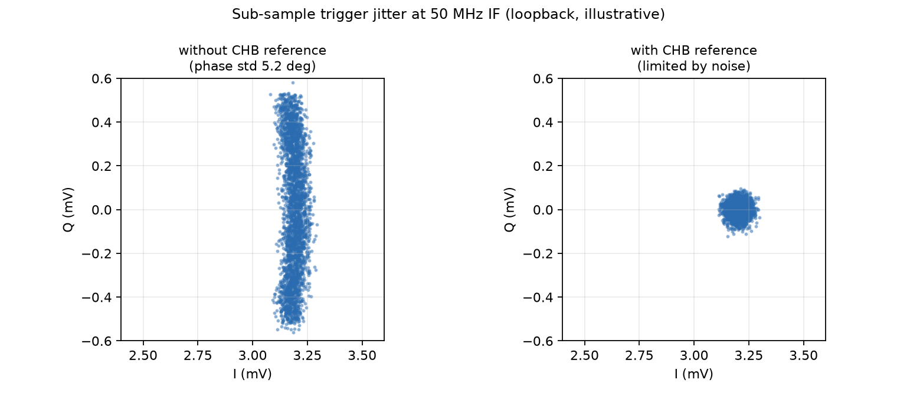
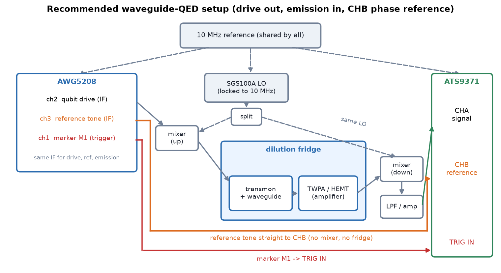
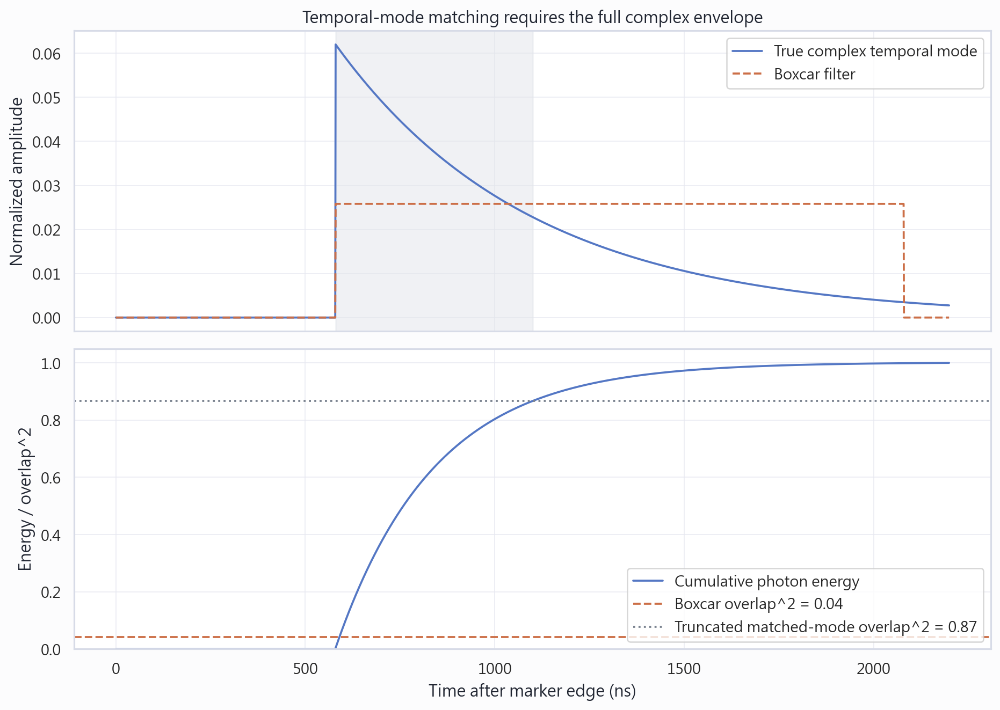
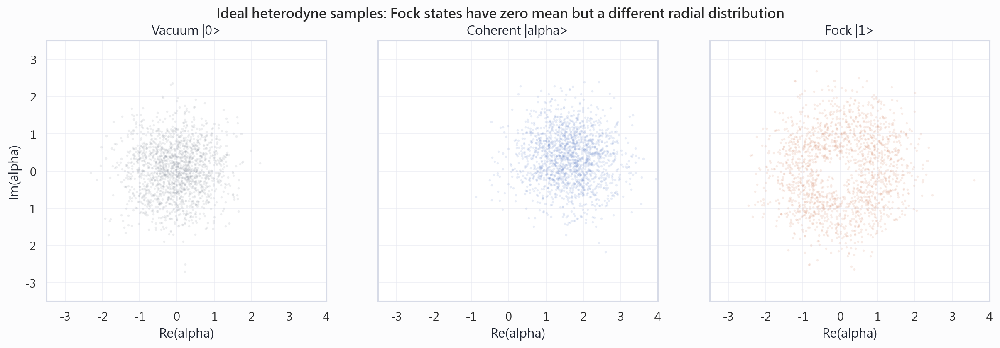
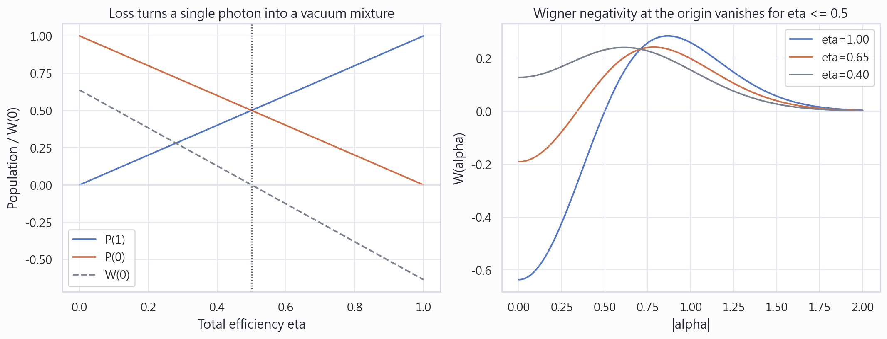

# QAWG Tomography 與 Wigner Function 操作指南

本文件整合 Waveguide QED / 微波單光子態層析（Photon State Tomography）與 Wigner Function 重建的完整流程，涵蓋：

1. [為什麼需要 Shot-by-Shot 與 CHB 相位參考](#1-為什麼需要-shot-by-shot-與-chb-相位參考)
2. [實驗接線與 IF 頻率選擇](#2-實驗接線與-if-頻率選擇)
3. [啟用雙通道與驗證 CHB](#3-啟用雙通道與驗證-chb)
4. [量測 Photon Emission Waveform](#4-量測-photon-emission-waveform)
5. [Photon State Tomography 與 Wigner Function 重建](#5-photon-state-tomography-與-wigner-function-重建)
6. [百萬級 Shots：Chunk Streaming 與 `tomo.py`](#6-百萬級-shotschunk-streaming-與-tomopy)
7. [校準要點與限制](#7-校準要點與限制)

---

## 1. 為什麼需要 Shot-by-Shot 與 CHB 相位參考

### 1.1 必須逐發（Shot-by-Shot）處理，不可先平均 Raw Data

量子態層析重建的是複振幅分佈 $P(\alpha)$ 與高階動差 $\langle (a^\dagger)^m a^n \rangle$。例如單光子 Fock state $|1\rangle$ 的平均振幅 $\langle a \rangle = 0$，若先把 raw data 或 IQ trace 平均掉，訊號會直接抵消歸零。因此必須對**每一個 shot** 個別解調並投影至 temporal mode，取得每發一個複數 $\alpha_k$ 後再做統計與重建。

### 1.2 為什麼需要 CHB 參考通道

以 loopback 實測資料（`tests/hardware/single_shot_clock`，3000 shots，50 MHz IF，分析腳本：[tests/hardware/analyze_trigger_phase_jitter.py](tests/hardware/analyze_trigger_phase_jitter.py)）檢驗：

- Shot 間相位標準差約 **5.2°**，呈均勻分佈，寬度正好對應 ±½ 個 ADC sample。
- 來源是外部 trigger 對 1 GS/s ADC 取樣時脈的 sub-sample 量化誤差，大小為 $360^\circ \times f_{\text{IF}} \times 1\,\text{ns}$（50 MHz 下為 18°/sample）。
- 整個 run 幾乎沒有慢漂移（0.01° / 1000 shots）。

對一般 dispersive readout 影響有限，但在 emission / tomography 中，相位模糊會直接抹平 Wigner function 的方向資訊。

**解法**：讓 AWG 另送一路固定頻率的**參考音**直接進 ATS 的 **CHB**。CHA 與 CHB 共用同一個 trigger 與取樣時脈，因此時間偏移完全一致；逐發扣除 CHB 量到的相位偏移，即可把 CHA 的 trigger 抖動消到接近雜訊極限。

```text
修正前：IQ 點沿圓弧散開（σφ ≈ 5.2°）  →  修正後：收斂至雜訊極限
```



> 降低 IF 也能線性縮小量化誤差（例如 20 MHz → 7.2°/sample），可與 CHB 修正並用。

---

## 2. 實驗接線與 IF 頻率選擇



### LO 與時脈接法（最關鍵）

1. **共用同一台 LO（SGS100A）**：輸出經 power splitter 分成兩路，分別接 up-mixer 與 down-mixer 的 LO 埠。上下變頻共用同一個 LO，LO 相位漂移會互相抵消，只剩 AWG 與 ATS 之間的相對關係（注意補償 splitter 約 3.5 dB 損耗，確保 mixer LO 功率達標，常見 +7 ~ +13 dBm）。
2. **共用 10 MHz 參考時脈**：SGS 後面板 `10 MHz REF IN`、AWG（`use_external_10mhz_reference()`）與 ATS（`use_external_10mhz_reference=True`）接同一組 10 MHz 參考源。
3. **頻率配置**：令 $f_{\text{LO}} = f_{\text{qubit}} - f_{\text{IF}}$，使 drive、emission 與參考音共用同一 IF：

```text
f_LO = f_qubit - IF
drive：    AWG 輸出 IF  → up-mixer   → f_LO + IF = f_qubit  （激發脈衝）
emission： f_qubit      → down-mixer → f_qubit - f_LO = IF  （進 ATS CHA）
參考音：   AWG 輸出 IF  → 直接進 ATS CHB（不經 mixer、不進 fridge）
```

4. **通道配置**：訊號進 `CHA`，marker 接 `TRIG IN`，參考音直接進 `CHB`（若硬體接反，將下方 `adc_channel` 與 `reference_channel` 對調即可）。

### 建議的 IF 頻率

| 項目 | 建議 |
| :--- | :--- |
| **建議 IF** | **50 MHz**（本專案預設值；可用範圍 25–100 MHz） |
| **避免過低（< 20 MHz）** | 接近 DC offset 與 1/f 雜訊、低通濾波難設計，且 drive LO 洩漏會靠 emission 太近 |
| **避免過高（> 150 MHz）** | 每 1 ns sample 對應相位誤差變大（100 MHz = 36°/sample），且受 AWG sinc 衰減影響 |
| **頻寬下限** | 至少大於 emission 頻寬（$\approx 1/(2\pi T_1)$）與脈衝頻寬的 5 倍以上 |
| **取樣整除** | 優先選 1 GS/s 可整除頻率：**20、25、40、50、100 MHz**，使 $2 f_{\text{IF}}$ 殘留項在整數週期內完全抵消 |

---

## 3. 啟用雙通道與驗證 CHB

### 3.1 連接 `AWGAlazar` 並開啟參考通道

```python
import numpy as np
import matplotlib.pyplot as plt
from QAWG import AWGAlazar, us

experiment = AWGAlazar.connect(
    "TCPIP0::192.168.10.171::inst0::INSTR",
    awg_sample_rate_hz=2.5e9,
    acquire_window_s=3 * us,
    adc_channel="CHA",              # 訊號通道
    reference_channel="CHB",        # 參考音通道
    reference_frequency_hz=50e6,    # 省略時預設與解調頻率相同
)
```

- 開啟 `reference_channel` 後，ATS 會同步擷取 CHA 與 CHB，每個 record 在解調前會先扣除參考音的相位偏移。
- `reference_window_ns=(start, stop)` 可指定估計參考相位的區間（預設為 integration window，參考音必須完整覆蓋此區間）。
- 修正量記錄在 `result.reference_deviation_rad` 與 `experiment.last_reference_deviation_rad`。

### 3.2 首次上機檢查

1. AWG CH3 送 50 MHz 參考音至 CHB，CHA 先不接，執行：
   ```powershell
   python tests/hardware/check_dual_channel.py
   ```
   預期看到 CHB 有訊號、CHA 僅有雜訊（若顛倒表示 DMA 通道排列不同，需檢查 `copy_dma_buffer`）。
2. 接上訊號後，檢查參考音是否有成功進入並被偵測到：
   ```python
   dev_deg = np.degrees(result.reference_deviation_rad)
   print("reference jitter std (deg):", dev_deg.std())  # 50 MHz 下約 5°；若接近 0 表示參考音未進 CHB
   ```

---

## 4. 量測 Photon Emission Waveform

在同一個 AWG sequence 中**交錯**安排 `reference`（無激發，量測 vacuum / 放大器雜訊）與 `signal`（打 $\pi$ pulse 後量測 emission），可自動抵消慢漂移並提供校準基準：

```python
from QAWG import ExperimentProgram, ValuesSweep, ns, us, MHz


class Emission(ExperimentProgram):
    def _initialize(self, cfg):
        self.declare_gen("qubit", ch=2, amplitude_vpp=0.5)
        self.declare_gen("ref", ch=3, amplitude_vpp=0.5)
        self.declare_readout(
            "ro",
            adc_channel="CHA",
            length=cfg["window"],
            demod_freq=cfg["emission_if"],
            marker_channel=1,
            marker_length=40 * ns,
            integrate_time=cfg["window"],
        )  # 不設 waveform_ch：不綁定 readout pulse
        self.state = self.add_sweep("state", ValuesSweep(("reference", "signal")))
        self.add_pulse(
            "pi",
            gen="qubit",
            style="gaussian",
            length=60 * ns,
            sigma=10 * ns,
            frequency=cfg["qubit_if"],
            gain=cfg["pi_gain"],
        )
        self.add_pulse(
            "ref_tone",
            gen="ref",
            style="const",
            length=cfg["window"],
            frequency=cfg["ref_if"],
            gain=0.5,
        )  # 參考音蓋住整個 window

    def _body(self, cfg):
        self.play("ref_tone", at=0)
        self.play("pi", at=100 * ns, when=("state", "signal"))
        self.trigger("ro", trigger_delay=0)


cfg = dict(
    window=2.5 * us,
    emission_if=50 * MHz,
    ref_if=50 * MHz,
    qubit_if=50 * MHz,
    pi_gain=0.5,
)
compiled = experiment.compile(Emission(cfg, final_delay_s=20 * us))
result = compiled.acquire(n_average=5000)

ref = result.iq_traces[:, 0, :]   # (shots, sample) vacuum reference
sig = result.iq_traces[:, 1, :]   # (shots, sample) emission signal
t_ns = result.iq_time_s * 1e9

mean_amplitude = sig.mean(axis=0)                                          # ⟨a⟩(t)
power = (np.abs(sig) ** 2).mean(axis=0) - (np.abs(ref) ** 2).mean(axis=0)  # 扣雜訊底之發光功率
```

`power` 的衰減曲線即為發光包絡，可用來決定下方 temporal mode 的起點與衰減時間常數。

---

## 5. Photon State Tomography 與 Wigner Function 重建

### 5.1 Temporal Mode 投影 + Maximum-Likelihood 重建

將每發 IQ trace 投影到歸一化的 **temporal mode**（$f(t)$，$\sum |f_k|^2 = 1$）得到每發複振幅 $\alpha_k$，再以 `reference` 校準零點與尺度，最後透過 ML 估計密度矩陣 $\rho$ 並計算 Wigner function $W(\alpha)$：



```python
from QAWG import (
    temporal_mode_weights,
    project_temporal_mode,
    normalize_heterodyne_reference,
    heterodyne_ml_density_matrix,
    wigner_function,
)

# 1. 建立 temporal mode（exponential 時 decay_samples 為能量衰減時間 T1，單位 sample）
t1_samples = int(300e-9 * 1e9)   # 例：T1_radiative = 300 ns @ 1 GS/s
mode = temporal_mode_weights(1000, kind="exponential", decay_samples=t1_samples)

# 2. 逐發投影（start_sample 通常設在 π pulse 結束後）
start = 200
ref_alpha = project_temporal_mode(ref, mode, start_sample=start)
sig_alpha = project_temporal_mode(sig, mode, start_sample=start)

# 3. 以 reference 去除 offset 並校準尺度
ref_n, (sig_n,), offset, scale = normalize_heterodyne_reference(ref_alpha, sig_alpha)

# 4. Maximum-Likelihood 重建密度矩陣並計算 Wigner function
rho = heterodyne_ml_density_matrix(sig_n, cutoff=6)
x = np.linspace(-3, 3, 121)
W = wigner_function(rho, x, x)

plt.imshow(W, extent=[-3, 3, -3, 3], origin="lower", cmap="RdBu_r")
plt.colorbar(label="W(α)")
plt.xlabel("Re α")
plt.ylabel("Im α")
print("P(0), P(1) =", np.real(np.diag(rho))[:2])
```

單光子態（$|1\rangle$）在原點 $W(0)$ 應呈現**負值**，為非古典態的直接證據：



### 5.2 高階動差與放大器雜訊反捲積（Moment Deconvolution）

實際量測鏈（HEMT / TWPA）含有 added noise $h^\dagger$，量測到的複振幅 $S = a + h^\dagger$ 是訊號與放大器雜訊的疊加。若已完成電壓至光子數的獨立校準（`volts_per_sqrt_photon`），可使用 `QAWG.tomography` 內的動差反捲積流程重建未受放大器雜訊稀釋的 $\rho$：

```python
from QAWG import (
    calibrate_iq_samples,
    complex_moment_stats,
    deconvolve_amplifier_moments,
    fit_density_matrix_from_moments,
    wigner_function,
)

# 1. 轉成無因次光子振幅單位（需先獨立校準 volts_per_sqrt_photon）
ref_cal, sig_cal = calibrate_iq_samples(
    ref_alpha,
    sig_alpha,
    volts_per_sqrt_photon=1.23e-4,
)

# 2. 計算參考態與訊號態的高階複動差 ⟨(S†)^m S^n⟩
ref_moments = complex_moment_stats(ref_cal, max_order=4)
sig_moments = complex_moment_stats(sig_cal, max_order=4)

# 3. 扣除放大器雜訊動差，取得訊號場動差 ⟨(a†)^m a^n⟩
signal_moments = deconvolve_amplifier_moments(sig_moments, ref_moments)

# 4. 透過半正定約束擬合密度矩陣 ρ（Tr(ρ)=1, ρ ⪰ 0）
rho = fit_density_matrix_from_moments(signal_moments, cutoff=4)
```

> 損耗與截斷維度（`cutoff`）對 Wigner 負值與收斂的影響可參考模擬腳本 [examples/simulate_transmon_wigner.py](examples/simulate_transmon_wigner.py) 與下方模擬結果：



---

## 6. 百萬級 Shots：Chunk Streaming 與 `tomo.py`

### 6.1 手動分批累積（避免爆記憶體）

`result.iq_traces` 佔用記憶體約為 `n_average × 2 × sample × 16 bytes`。需要數十萬以上 shots 時，請分批 `acquire`、即時投影並釋放 raw trace：

```python
alphas_ref, alphas_sig = [], []
for _ in range(20):
    r = compiled.acquire(n_average=5000)
    alphas_ref.append(project_temporal_mode(r.iq_traces[:, 0, :], mode, start_sample=start))
    alphas_sig.append(project_temporal_mode(r.iq_traces[:, 1, :], mode, start_sample=start))
    del r

ref_alpha = np.concatenate(alphas_ref)
sig_alpha = np.concatenate(alphas_sig)
```

> 跨批累積且使用 CHB 參考音時，請固定 `reference_center_rad`，避免不同 batch 各自以當批圓形平均作為 0 相位。

### 6.2 使用內建 CLI 工具 `tomo.py`（Single-HEMT Streaming）

針對 5.9 GHz 附近、50 MHz IF 的單 HEMT 系統，可直接用根目錄的 [tomo.py](tomo.py) 進行百萬級 shots 串流擷取（每批即時投影為單一複數 $\alpha_k$ 後丟棄 raw chunk）：

```powershell
# 1. 串流擷取（交錯 reference / signal）
python tomo.py hemt-stream `
  --device-frequency 5.9e9 `
  --if-frequency 50e6 `
  --total-shots 1000000 `
  --chunk-shots 2000
```

- 連續驅動螢光使用預設 boxcar mode（校準 `--tomo-mode-start-ns` 與 `--tomo-mode-ns`）；
- 脈衝釋放態改用指數衰減 mode（`--tomo-decay-ns` 為**振幅**壽命）：

```powershell
python tomo.py hemt-stream --tomo-mode decay --tomo-decay-ns 60
```

- 執行前先確認產出的 `stream_mode_calibration.png`；完成 IQ leakage、vacuum reference、損耗、熱光子數與 `volts_per_sqrt_photon` 校準後再執行分析與 Wigner 重建：

```powershell
python tomo.py analyze-hemt `
  --data-dir tomodata\YYYYMMDD_HHMMSS `
  --photon-scale-volts 1.23e-4
```

---

## 7. 校準要點與限制

- **`normalize_heterodyne_reference` 的尺度意義**：該函式會將 `reference` 變異數直接歸一為 1 單位 vacuum；在未做獨立光子數校準（`calibrate_iq_samples`）與雜訊反捲積前，所畫 Wigner function 會因 HEMT/TWPA added noise 而較寬、負值較淺。
- **Ideal ML vs Moment Deconvolution**：`heterodyne_ml_density_matrix` 假設理想 heterodyne（Husimi $Q$ 分佈），未內建 added noise 反捲積；有顯著放大器雜訊時請使用 `deconvolve_amplifier_moments` + `fit_density_matrix_from_moments`（或 `tomo.py analyze-hemt`）。
- **Mode Matching 效率**：每發只投影單一 temporal mode，若 mode 形狀或 `start_sample` 與實際發光包絡不符，會直接損失等效量測效率。
- **硬體規格限制**：ATS9371 擷取固定 1 GS/s、50 Ω、DC coupling、±400 mV；單次 `ExperimentProgram` 支援一個 `"ro"` readout。
