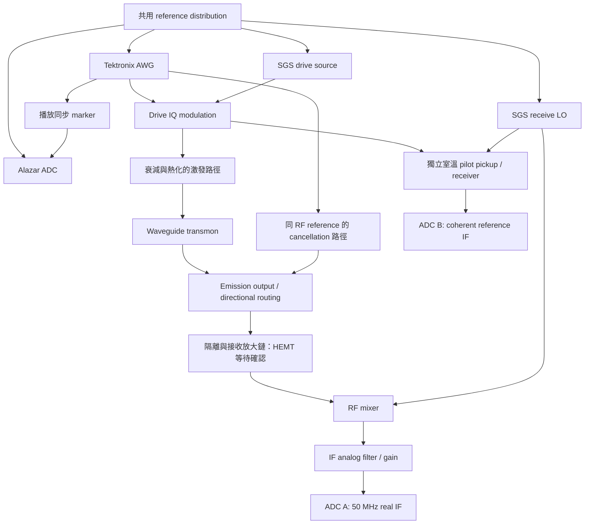

# Waveguide transmon fluorescence：從 50 MHz IF 到時間波形與 photon tomography

研究日期：2026-09-08。依據原始研究論文、儀器官方手冊、你的 HDF5 與本地 QAWG 程式。這是針對現有系統的設計研究，不是已完成的硬體校正或量子態重建。

## 1. 結論與已知配置

**共用一條逐 shot 擷取流程，再分成「寬頻時間波形」與「固定時間模式 tomography」兩個分析分支。不要只存 Average record，也不要讓顯示用的平滑設定決定 tomography 的資料。**

你已確認：一台 Tektronix AWG、一台 Alazar digitizer、兩台以上 SGS100A；ADC A 量接收訊號；ADC B 可作室溫 loopback phase reference；沒有 TWPA。精確 AWG／ADC 型號尚未由你確認，本地程式針對 AWG5208／ATS9371。HEMT、JPA、低溫隔離器、RF/IF 濾波器與增益仍待盤點。下文假設 A 接的是經放大與類比混頻後的 50 MHz IF，而不是直接接 GHz 微波。

現有資料主要是已平均 IF。能研究相干場，但丟失了多數量子統計。掃 power 的各點不是同一態的重複 shots。你的原 Labber 解調本身也是 20 ns 滑動平均，並非無濾波；先前使用的 20 MHz／101 taps FIR 不是等效替代品。

## 2. 先決定要觀察的物理量

| 目的 | 應計算的量 | 不能替代它的量 |
|---|---|---|
| 時間相干場／dipole Rabi | 每個時間的複數平均 E[z(t)]，保留 I、Q | 逐 shot 自行轉正相位後的平均 |
| 時間 emission 強度 | E[abs(z(t))²]，使用一致帶寬並扣接收背景、校正增益 | abs(E[z(t)])²，只是相干部分 |
| Mollow／fluorescence spectrum | 逐 record 頻譜功率平均或二時刻相關，再扣背景與鏈路響應 | 對平均 waveform 做 FFT |
| 單一 traveling mode 量子態 | 每個 shot 的固定模式投影 S_j，保留完整分布 | 功率掃描曲線或平均衰減 waveform |

pi pulse 後單光子態可以有零平均場，因此 time waveform 消失不代表沒有 photon。你提供的 Lu 等人圖 (c) 是 pi/2 準備後的相干衰減，文章的 tomography 則另做 single-shot 模式投影。論文不是從平均衰減曲線直接生成 Wigner。[Lu et al., 2021](https://www.nature.com/articles/s41534-021-00480-5)

對同一數位帶寬，E[abs(z)²] 與 abs(E[z])² 的差是接收後的 fluctuation 成分，仍包含放大器／真空背景；不能未校正就稱為 qubit 非相干光子數。頻寬受限的量測得到的是該頻寬內的強度。

## 3. 適合你儀器的接線概念



這是訊號功能圖，實際取消端口位置要對照你的 coupler／circulator 接線，不代表所有元件已安裝。

建議頻率規劃：接收 LO 設 f_LO = f_q − 50 MHz，則輸出在 ADC 上的載波為正 50 MHz。若使用上側 LO，解調的共軛／Q 符號會改變，必須用已知 coherent tone 驗證，並寫入 metadata。

兩台以上 SGS 可分工：一台提供激發載波，一台接收 LO；cancellation 優先共用激發 RF 載波，再獨立調 envelope、相位和延遲。若用不同源，不應僅因 reference 都設 EXT 就假定 cancellation 相位穩定。若硬體支援共 LO、或使用共載波外接 IQ mixers，可以降低相對 RF 漂移，但是否需要新增 mixer／選件要視 SGS 配置。

R&S 官方手冊明言：只共享 10 MHz，長期頻率可一致，但瞬時相對相位仍會漂移；SGS-K90 提供 LO coupling。確認你的選件再接 LO，不能把 REF 模式與 LO 模式混用。[SGS100A manual, §§9.3, 11.7](https://scdn.rohde-schwarz.com/ur/pws/dl_downloads/pdm/cl_manuals/user_manual/1173_9105_01/SGS100A_UserManual_en_13.pdf)

AWG marker 應從實際 waveform 播放時序產生，先啟動 ADC 等待，再播放 pulse。外部非同步 trigger 可能有 frame timing uncertainty，不能靠軟體呼叫時間定位脈衝。[Tektronix AWG5200 technical reference](https://download.tek.com/manual/AWG5200-Series-Specifications-and-Performance-Verification-077133501.pdf)

Cancellation 的目的是降低接收端 coherent leakage，不是移除所有量子 emission。要在不同 AWG amplitude 下量 qubit-detuned、cancel on/off 的複數脈衝，建立背景查表；不要在 qubit resonant 的 emission 上直接最小化整段功率，否則可能把真正的相干散射一起抵消。接收鏈任何一級飽和都不能靠事後 subtraction 救回。若 cancellation 在第一放大器之後，它無法防止更前級壓縮。

## 4. ADC B 的用途與限制

現階段建議 B 保留作相位／時序 reference，不急著改成雙接收鏈 tomography。

室溫 pilot 應使用與 drive 有確定相位關係的 RF，並經與 A 共用的 receive LO 下混頻。只把 AWG 的 50 MHz 電波直接接 B，只能查 AWG–ADC 時序，不能觀測兩台 SGS 間的 RF 相位漂移。

每個 shot 從獨立、高 SNR pilot 求 phi_j，對 A 做 z'_j(t)=z_j(t) exp(−i phi_j)。已知的 preparation phase／AWG programme phase需單獨記錄，不能把刻意準備的相位一起扣掉。pilot 應在 signal、vacuum reference shots 中使用相同程序；避免 B 串入 A 或造成壓縮，實測 pilot on/off 對 A 的影響。

不能使用微弱 emission 自己估計逐 shot 相位再轉正，那會把量子／雜訊分布重塑成偏向正振幅。室溫 pilot 也不能追蹤 fridge 路徑所有漂移，需穿插 coherent calibration blocks。單一固定 phase reference 可解純 phase offset，但不能同時辨識頻率誤差、時間移位與色散；必要時擬合 pilot 的 phase slope／pulse timing。

B 作 reference **不是**第二套獨立 amplification detector。將一個共同放大器後的訊號分到 A/B，不會消去共同的放大器雜訊。

## 5. Alazar 的原始擷取

若確為 ATS9371，官方規格是雙通道、12-bit、最高 1 GS/s；external 10 MHz reference 與 fast external sample clock 是不同模式。NPT 擷取只含 trigger 之後的資料，record length 至少 256 並以 128 對齊。因此要有 pre-pulse baseline，可讓 AWG marker 提早，waveform 晚一段時間才開始。[ATS9371 manual](https://www.alazartech.com/en/download/product/646/530/)

以實測訊號 duration 設 record：前置空白 + excitation + emission tail + FIR guard。不要沿用 1000 samples 就假設 1 us 足夠；尾段要涵蓋要研究的衰減，並留背景窗。重複週期由實測復位與熱激發決定，不只看 AWG 最短周期。

保留每個 shot 的 ADC codes、轉換比例和 records_volts。檢查 clipping、record count、buffer overflow、shot/step 對應及實際 sample interval。12-bit ADC 以 16-bit containers 傳輸時，必須用 SDK／driver 的碼對齊轉換，不可把 uint16 全尺度當作 ADC 實際位元數。

先確認在只有接收雜訊時 ADC 有可解析的碼變動，同時最大 drive leakage 不會 clipping；根據實測 gain/壓縮選 IF gain。ADC noise 明顯低於前級放大器輸出雜訊，才不會讓 digitizer 主導量測。不能只因 12-bit 就判斷是否能 tomography。

工程儲存量：1 GS/s、2 us、兩 channel、uint16，一百萬 shots 約 8 GB（不含 metadata）。初期保留原始資料以測濾波；大量正式 shots 可分批處理，保留全數模式 IQ、部分原始 traces 與分塊統計，不需一次把全部 RAM 吃滿。

## 6. 50 MHz real IF 的正確 DDC／頻寬設計

以下為訊號處理推導與針對本地 code 的數值驗證，不是某台儀器的固定推薦設定。

令 real IF 為 x(t)=Re[s(t) exp(i 2π f_IF t)]。則

`2 x(t) exp(-i 2π f_IF t) = s(t) + s*(t) exp(-i 4π f_IF t)`。

50 MHz IF 經 DDC 後，目標在 0 附近，共軛影像中心在 −100 MHz。若目標 complex envelope 需保留 ±B，影像最近的邊緣約為 −(100−B) MHz。實數 IF 要無歧義保留任意 complex envelope，通常需 B < 50 MHz 且留過渡帶，並確認 RF/IF 類比鏈路通過 50±B MHz。

因此應先定義：

- `f_pass`：需要幾乎不衰減的最大物理頻率。
- `f_stop`：從哪裡開始充分抑制影像／干擾。
- 通帶容許誤差、阻帶抑制、允許脈衝邊緣影響長度。

不要把 Ω（rad/s）直接當 MHz；Rabi 側帶的頻率偏移為 Ω/(2π)。要看 30 MHz 振盪，cutoff=30 MHz 的 windowed-sinc FIR 通常已在明顯衰減位置，並不是「完整保留到 30 MHz」。

**本地 QAWG 的實例：fs=1 GS/s、IF=50 MHz、Kaiser beta=8。**

| 設計 | 20 MHz 訊號增益 | 30 MHz 訊號增益 | 每端 guard |
|---|---:|---:|---:|
| 原先 cutoff 20 MHz／101 taps | −5.885 dB | −17.420 dB | 50 ns |
| 比較用 cutoff 50 MHz／181 taps | 約 0 dB | 約 0 dB | 90 ns |

第二例針對 **通帶 0–30 MHz、阻帶 70 MHz 以上**，不是宣稱能平坦保留 50 MHz。附帶 `filter_check.py` 檢查整段頻率的極值，並以已知 5/20/30 MHz envelope 驗證恢復幅度。這是理想 DSP 測試；仍需室溫 loopback 校正 RF/IF 硬體頻率響應。

若要保留超過 50 MHz 的任意基頻訊號，僅放寬低通不能解開已重疊的 real IF 頻譜。考慮提高 IF，或類比 I/Q 接收；後者需要 A/B 同步接 I/Q，會占用目前的 reference B。IF 提高仍要符合 analog bandwidth、anti-aliasing 與 ADC Nyquist。

固定線性 FIR 不會搬移單一正弦的頻率，但會改變多成分比例、邊界與經 magnitude 後的峰形。正確評估應在複數 I/Q 與已知 test tone 上做，不能只數 abs(IQ) 波峰。

`fir_lowpass_iq` 是 centered convolution，輸出已對齊中點；頭尾半個 kernel 受補零影響。原 Labber 的 20-sample valid boxcar 標在窗起點，中心為 +9.5 ns。取 200 ns 平均還會加上 sinc 頻率響應，不能拿來觀察窗內快速 Rabi。

初期不 decimate；若需降低資料量，必須先 anti-alias，讓阻帶在新 Nyquist 前達標，再下採樣；mode weights、time axis、gain calibration 隨之更新。離線 zero-phase 處理也不等於沒有幅度變化，例如 filtfilt 的總幅頻響應是原濾波器的平方。

## 7. 分支 A：時間 waveform 與 fluorescence

每個 shot 保持複數波形：ADC codes → volts → 必要的 ADC baseline 校正 → DDC → 驗證過的低通 → 獨立 pilot phase correction。

保留 `iq_shots[step, shot, time]`，從同一組資料產生 mean I/Q 與 mean abs(IQ)²。漂移可分 block 觀察。coherent leakage 使用獨立量得的複數 mean background；不要用一筆隨機 vacuum shot 從一筆 signal shot 相減，這只會引入額外雜訊。

避免每個 shot 扣掉包含 emission 的整段 baseband mean，這會消除 mode 的一部分。使用 pre-pulse baseline 也會引入估計誤差／相關性，因此 signal 和 reference 必須採相同程序，並保存所用 window。

時間 Rabi 可固定振幅、改 pulse duration，或直接看 pulse 中的 I/Q；分析模型應包含實際 Gaussian envelope、失諧、Gamma1/Gamma2 及鏈路 convolution。強驅動接近 transmon 非諧性時需考慮更高能階。不要用單個波瓣硬套 sine 得到 pi pulse。

頻谱用逐 shot 的 windowed FFT power／相關函數；避免把 finite record truncation 當物理側帶。比較多個已驗證 passband，若頻率／對比随滤波大幅變動，尚不能宣告是物理 Rabi。

## 8. 分支 B：選定一個 temporal mode

連續模式定義 `a_f = ∫ f*(t) a_out(t) dt`，並令 `∫|f(t)|²dt=1`。數位模式可使用 `Σ|w[n]|²=1`，每個 shot 得 `S_j=Σ w*[n] z_j[n]`。這個數值仍是電壓模式座標，尚未自動變成 photon amplitude。

先在獨立 calibration data 決定 f，正式 signal/vacuum/shots 都用同一 f。單純指數 emission 的候選 amplitude mode 是 `f(t) ∝ exp[-(t-t_off)/(2 T1)]`。不能把 pi/2 平均 coherence 的衰減 T2 無條件當 photon mode 的 T1；存在純退相干時二者不相同。Lu 實驗也明確區分兩者。[Lu et al., 2021](https://www.nature.com/articles/s41534-021-00480-5)

FIR 與 mode projection 共同定義實際量到的模式；需把濾波器與硬體傳遞函數算進校正。colored noise 下最佳 SNR 權重可能涉及 noise covariance，但那會改變被量測的 mode，必須重新做物理標定。對複雜 emission，可由獨立校正的背景扣除二時刻相關研究主要模式，不能只以平均波形决定所有態的模式。

時間圖可以很寬頻，mode projection 可以專注一個較窄的 photon wavepacket；兩者不矛盾。對匹配模式做積分不是把 quantum state 平均掉，因為每個 shot 仍留下一個隨機複數樣本。

## 9. 沒有 TWPA，怎麼走到 tomography

沒有 TWPA 並非原理障礙；需先確認 HEMT／其他放大器、鏈路效率和穩定性。高 added noise 會讓高階 moments 的精度取得成本急遽增加，不能只承諾某個固定 shots 數就一定能成功。[Eichler, Bozyigit & Wallraff, 2012](https://arxiv.org/html/1206.3405v2)

建議交錯收四類 blocks：signal（固定準備態）、vacuum/no-drive（同一接收鏈設定）、已知 coherent calibration、qubit-detuned cancellation background。後者處理 drive leakage，不等同 vacuum 雜訊校正。若 noise 與 signal 因放大器壓縮／驅動串扰相關，單純獨立加性 noise model 失效。

模式 gain 必須以物理標準建立：例如校正過的 coherent tone 與鏈路 gain，或經驗證的 source/thermal-noise 校正。HEMT dominated reference 的總方差包含 added noise，不能只除以 vacuum RMS，把任意放大器雜訊強制變成 ideal vacuum，再套 ideal heterodyne likelihood。

重建可採兩條路：

1. 由 signal/reference 的模式樣本求混合 moments，依 noise model 逐階解出 normally ordered moments，再做帶物理限制的 density-matrix 擬合。高階修正不是每階直接減掉 vacuum 數值。
2. 以校正後 noise／loss 的 forward measurement model，對複數 histogram 做 maximum likelihood；得到 rho ≥ 0、Tr rho=1。histogram 本身是含量測雜訊的分布，不是 Wigner。

這兩條方法的正式依據與雜訊分解見 [Eichler et al., 2012](https://arxiv.org/html/1206.3405v2)；以線性放大器及低階 moments 重建 itinerant single-photon 的實驗先例見 [Eichler et al., 2011](https://arxiv.org/abs/1011.6668)。不要把受限 Fock space 下少量 moments 的成功推廣成「任意態只需四階」。

實作驗收提案：先 vacuum、已知 coherent state、再 pi/2、最後 pi。探索性 pilot 可先 10^5–10^6 shots/condition 估算誤差與漂移，再依 block-bootstrap 的 uncertainty 決定追加；這是容量規劃起點，不是精度保證。不應以同一資料優化 mode／postselection 後，仍宣稱原先的誤差界限。

重建報告要包含 mean photon number、g2（分母接近零時不穩定）、rho 對角／非對角、Fock cutoff 敏感度、reference 漂移與 confidence interval。bootstrap 的單位是 shots 或時間 blocks，不是 FIR 相鄰 samples。

Wigner 由 rho 計算：`W(alpha)=2/pi Tr[D(-alpha) rho D(alpha) parity]`。分別標明是 receiver-plane detected state、或依獨立 loss model 推回 source-plane 的 state。loss correction 不能靠「調到負值出現」選參數。

自行可推導的 sanity check：若單一模式只是 `(1-eta)|0><0|+eta|1><1|`，則 `W(0)=2/pi(1-2eta)`。此特定模型 eta>1/2 才中心為負；不代表所有態都用同一效率門檻，也不代表無負值就沒有非經典性。added noise 與傳播 loss 的校正要分清。

## 10. 你現有 QAWG 程式的具體落點

下列為本地 code inspection，不是已連上硬體驗證。

| 模組／函式 | 可用能力 | 需處理的限制 |
|---|---|---|
| `QAWG/alazar/dsp.py` 的 downconvert、fir_filter | real IF → complex IQ；可保留時間軸 | cutoff 需驗證，保留 guard；不要把 factor 2 的峰值電壓慣例混作 RMS |
| `CaptureData.raw_codes / records_volts` | 可取得逐 record 資料 | 正式保存不可只取 average |
| `CaptureConfig` | 現固定 1 GS/s、±400 mV | 目前 channel 只接受 A **或** B；不支持 A|B 同步雙通道配置，需增加 DMA layout 與配對驗證 |
| `configure_clock` | internal 或 external 10 MHz reference | 本地這條路尚未提供 fast external clock 選項，舊 Labber 的模式不能直接套用 |
| `compiled_averages` | raw/iq_traces/iq_shots 仍保留 repeat 與 step 軸 | integration 預設 boxcar；需指定／保存模式權重 |
| `temporal_mode_weights`, `project_temporal_mode` | 指數權重與逐 shot 投影 | `decay_samples` 對應 intensity T1/dt，函式內 amplitude 指數含 1/2；不是已校正 photon units |
| `heterodyne_ml_density_matrix` | ideal heterodyne likelihood | 目前不含你的 HEMT/added-noise 模型，不可直接投入 noisy volts／任意 RMS normalized IQ |
| `wigner_function` | 從 rho 畫 Wigner | rho 與 measurement model 必須先物理可信 |

Labber 輸出平均圖可作瀏覽副本，但正式 tomography 建議另存 HDF5 arrays：

```text
/raw/adc_A_codes       [block, shot, sample] 或分塊檔
/raw/adc_B_codes       同步 reference；若啟用
/derived/mode_IQ       [condition, shot, mode]
/derived/pilot_phase   [condition, shot]
/calibration/vacuum_mode_IQ
/calibration/coherent_mode_IQ
/calibration/cancel_background
/processing/fir_coefficients
/processing/mode_weights
/metadata/condition_table, actual_shot_count, sample_rate, IF_sign,
  trigger_delay, t0, ADC_scaling, RF/LO_frequency, AWG_waveform_hash,
  gain_reference_plane, noise_calibration, block_time, code_version
```

signal 與 reference 的有效 shot count、截掉的 guard、重排順序、被排除的 blocks 都要保存。需要換 mode 的原始驗證資料不可全刪。

## 11. 實際執行順序與通過條件

| 階段 | 做什麼 | 通過條件 |
|---|---|---|
| 1. 配置確認 | 型號、HEMT/增益鏈、實際 LO/IF、A/B 接線、clock options | 知道每個保存量對應哪個物理點 |
| 2. 室溫 loopback | 已知 envelope/phase；比較多個通帶；pilot on/off | 頻率、振幅與相位在容許誤差內，A 無 clipping／B 串音問題 |
| 3. cancellation | qubit detuned，逐振幅 cancel on/off | 殘留背景可量化，放大器工作在線性範圍 |
| 4. 時間物理 | 寬頻 I/Q、強度、duration Rabi、T1/T2 | 調整合理 passband 後物理結論穩定 |
| 5. 收集模式 shots | 固定模式；signal/vacuum/coherent 交錯 | shot pairing 正確，分塊均值與 noise 漂移受控 |
| 6. 重建驗證 | 含雜訊模型；先 vacuum/coherent | 能重現獨立校正態，不靠自行 rescale 得到目標 |
| 7. photon rho/Wigner | pi、pi/2；增加 shots；loss 敏感度 | 有 uncertainty、模型檢查與收斂，不能只交一張光滑 Wigner 圖 |

目前最值得先做的工程工作：**讓 A/B 真正同步逐 shot 保存、建立 pilot 校正、用已知訊號驗證時間波形濾波器。** 不是先換一個更窄的 FIR，也不是直接呼叫現有 ideal tomography 函式。

## 12. 研究邊界與交付

這是針對你的實驗的定向文獻研究，不是系統性文獻回顧。引用原始論文與官方手冊；工程門檻／測試順序是本文提案，須以你的 gain、T1/T2、bandwidth 實測修訂。沒有操作硬體或改動 QAWG production code。附帶數值驗證僅檢查 DSP，不能證實 photon tomography 的可行精度。

附檔：`filter_check.py`（以 labberenv 執行）、`filter_validation.json`、`filter_response.png`。本地已有資料可重做寬頻 waveform；但已平均而丟失的 single-shot 分布，需要重新量測。
